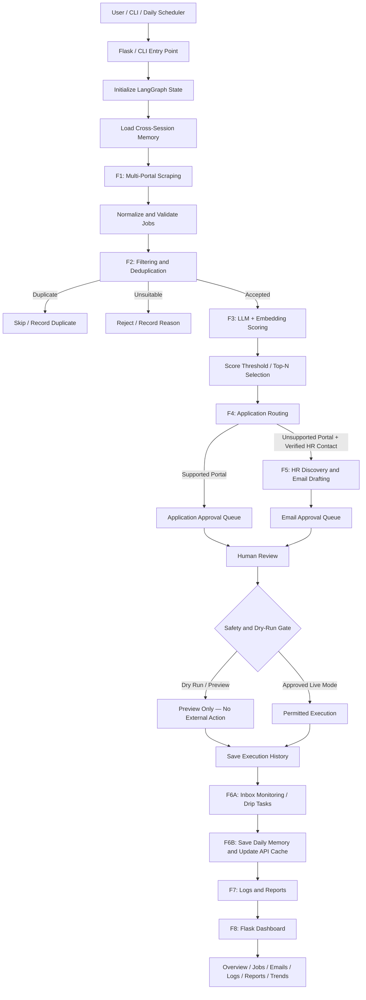
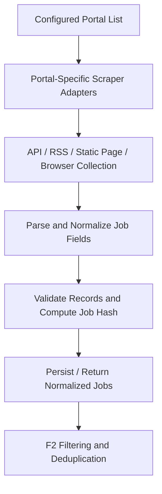
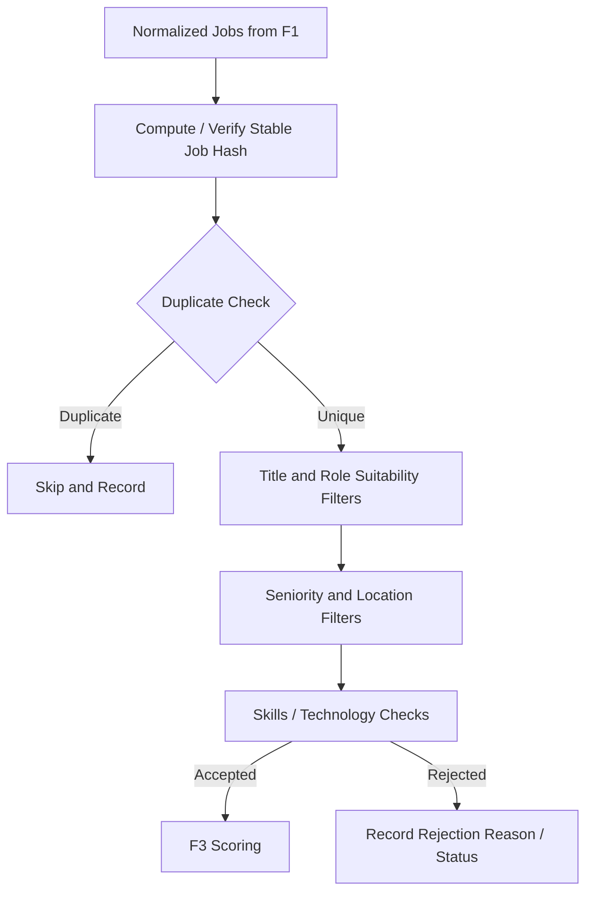
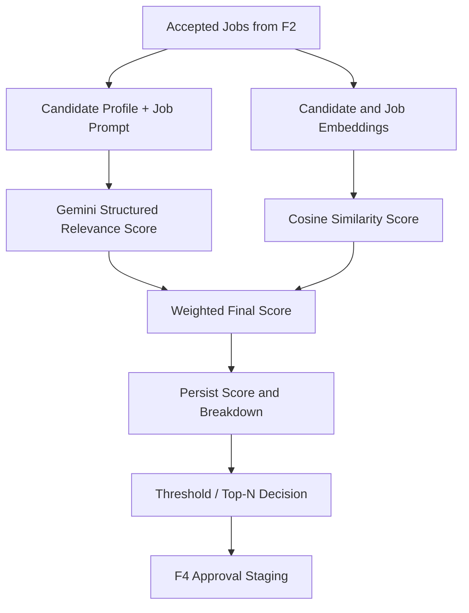
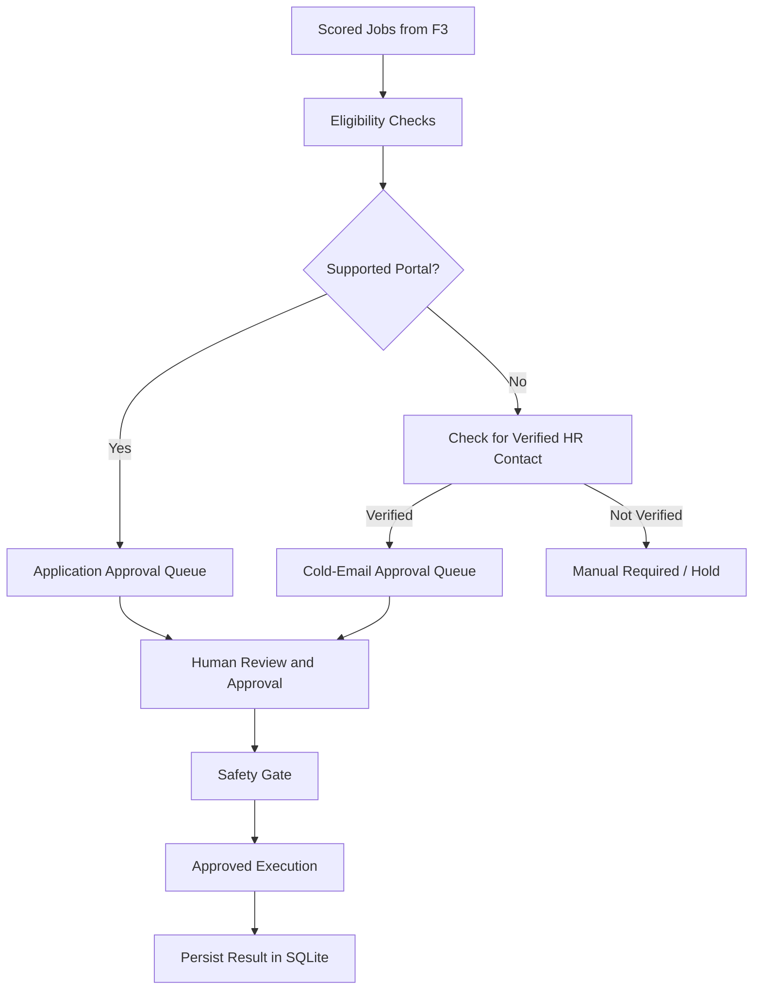
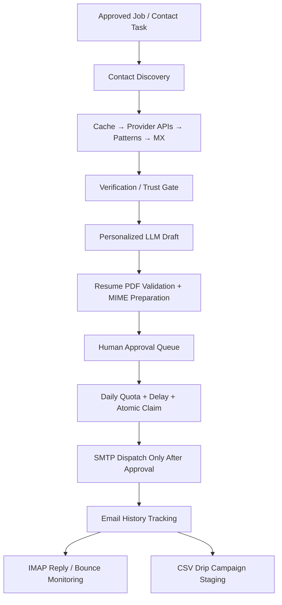
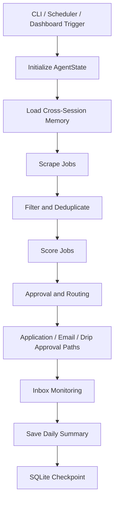
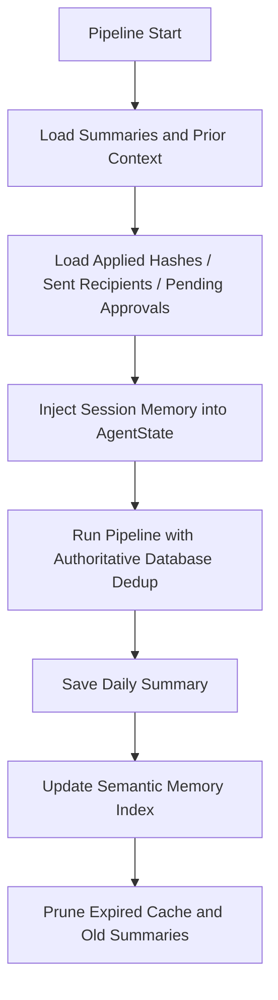
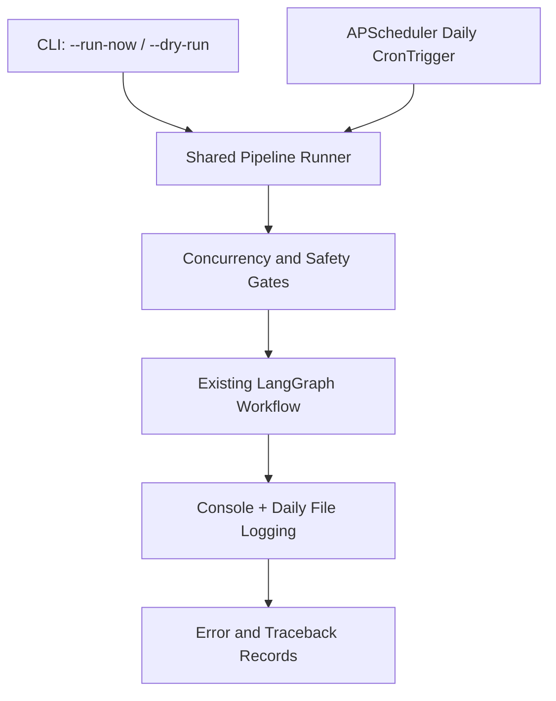
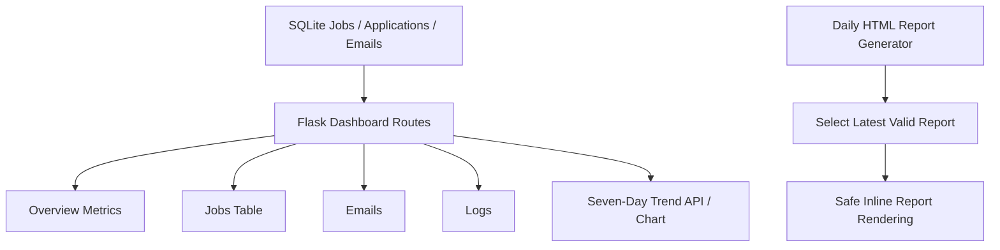

# AUTOHIRE.AI — Project Documentation

<p align="center">
  <strong>AI-ASSISTED JOB DISCOVERY & APPLICATION MANAGEMENT PLATFORM</strong><br>
  <strong>Prepared by: Manoj Kumar Mandal</strong><br>
  <strong>Batch: AI Batch-6</strong>
</p>

---

## Table of Contents

1. [Project Overview](#1-project-overview)
2. [Problem Statement](#2-problem-statement)
3. [System Objectives](#3-system-objectives)
4. [Technology Stack](#4-technology-stack)
5. [Complete System Workflow Architecture](#5-complete-system-workflow-architecture)
6. [Module-to-Module Data Flow](#6-module-to-module-data-flow)
7. [Functional Modules](#7-functional-modules)
   - [F1 — Multi-Portal Job Scraper](#f1--multi-portal-job-scraper)
   - [F2 — Intelligent Filtering and Deduplication](#f2--intelligent-filtering-and-deduplication)
   - [F3 — LLM Job Scoring](#f3--llm-job-scoring)
   - [F4 — Application Engine](#f4--application-engine)
   - [F5 — HR Discovery and Cold Email System](#f5--hr-discovery-and-cold-email-system)
   - [F6A — LangGraph Agent Graph](#f6a--langgraph-agent-graph)
   - [F6B — Cross-Session Memory](#f6b--cross-session-memory)
   - [F7 — Scheduler, CLI and Logging](#f7--scheduler-cli-and-logging)
   - [F8 — Real-Time Monitoring Dashboard](#f8--real-time-monitoring-dashboard)
8. [Architecture Decisions](#8-architecture-decisions)
9. [LLM Prompt Design](#9-llm-prompt-design)
10. [Challenges and Reported Resolutions](#10-challenges-and-reported-resolutions)
11. [Testing and Runtime Evidence](#11-testing-and-runtime-evidence)
12. [Security, Privacy and Operational Safeguards](#12-security-privacy-and-operational-safeguards)
13. [Future Improvements](#13-future-improvements)
14. [Conclusion](#14-conclusion)

---

## 1. Project Overview

**Autohire.ai** is an AI-assisted job discovery and application management platform. It is designed to collect vacancies from configured job portals, normalize and filter listings, remove duplicates, score relevance against a candidate profile, and stage suitable opportunities for human review.

Supporting services manage application workflows, HR contact discovery, personalized email drafts, approvals, execution history, cross-session memory, scheduling, logging, and a Flask monitoring dashboard.

The project follows a safety-first approach. The reported configuration keeps dry-run enabled and requires human approval. Real applications and emails must remain blocked during tests and require the appropriate approval before execution.

### Key capabilities

- Multi-portal job collection.
- Job normalization, filtering, and deduplication.
- Gemini-based job relevance scoring.
- Semantic similarity scoring using SentenceTransformers.
- Human-reviewed application and cold-email approval workflows.
- HR contact discovery and personalized email drafting.
- Gmail SMTP/IMAP integration.
- Stateful LangGraph workflow orchestration.
- SQLite-based cross-session memory and API caching.
- APScheduler-based recurring execution.
- CLI controls, structured logging, and Flask monitoring dashboard.

---

## 2. Problem Statement

Searching across multiple job portals, comparing role requirements with personal skills, removing duplicate or irrelevant listings, preparing tailored applications, finding HR contacts, and tracking follow-ups can be repetitive and fragmented.

Autohire.ai aims to centralize these activities:

- Collect jobs from multiple configured sources.
- Normalize listings into a common schema.
- Filter unsuitable roles and remove duplicates.
- Score relevance using candidate-profile information and LLM-assisted analysis.
- Stage opportunities for human review.
- Discover HR contacts and prepare personalized outreach drafts.
- Track approvals, applications, emails, and execution states in SQLite.
- Preserve useful context between runs.
- Schedule pipeline execution and expose activity through a dashboard.

**Objective:** Reduce repetitive job-search administration while keeping the candidate in control of consequential actions.

---

## 3. System Objectives

1. Automate collection of job listings from configured sources.
2. Standardize job data for consistent downstream processing.
3. Remove duplicate and unsuitable listings.
4. Prioritize jobs according to candidate skills and preferences.
5. Manage application and email tasks through approval queues.
6. Preserve run history and context across sessions.
7. Provide safe scheduling, logging, and operational monitoring.

---

## 4. Technology Stack

| Area | Technology |
|---|---|
| Programming language | Python 3.12 |
| Web framework | Flask |
| Database | SQLite |
| Workflow orchestration | LangGraph |
| Scheduling | APScheduler |
| Browser automation | Playwright |
| LLM integration | Gemini API |
| Email | Gmail SMTP / IMAP |
| Semantic embeddings | SentenceTransformers |
| Dashboard charts | Chart.js |
| Frontend | Flask templates, HTML, CSS, JavaScript |

---

## 5. Complete System Workflow Architecture

The following diagram shows how a run moves through the main services. The approval gates are intentional: the system can discover, analyze, prepare, and stage work automatically, but real applications and emails remain subject to human approval and the configured safety mode.



### Important execution rule

A job being found or scored does **not** mean an application was submitted. An email being drafted or staged does **not** mean it was sent. The system should record each state separately, and only proceed to a real external action after the required human approval and safety checks.

> **F6 naming note:** The assignment material refers to F1–F8. Cross-session memory was also discussed in a separate assignment excerpt labelled F6. To avoid merging two distinct requirements, this documentation labels them **F6A (LangGraph)** and **F6B (Cross-Session Memory)**.

---

## 6. Module-to-Module Data Flow

| From | Output passed forward | To |
|---|---|---|
| F1 Scraper | Normalized job records and source metadata | F2 |
| F2 Filter | Unique, relevant jobs and rejection reasons | F3 |
| F3 Scoring | LLM score, embedding score, final score, and breakdown | F4 |
| F4 Application Engine | Application or cold-email approval items | Human approval / F5 |
| F5 Email System | Verified contact status, draft, attachment metadata, send/reply status | Approval queue / F6A |
| F6A LangGraph | Orchestrated state, node results, checkpoint/thread state | F6B and services |
| F6B Memory | Startup context, daily summary, cache, and semantic-memory records | Next run |
| F7 Scheduler/CLI | Trigger, run mode, and logs | LangGraph |
| F8 Dashboard | Read-only operational metrics and history | User |

---

## 7. Functional Modules

### F1 — Multi-Portal Job Scraper

**Purpose:** Collect vacancies from configured job sources and normalize them for downstream processing.

**Reported integrations:**
- RemoteOK
- WeWorkRemotely
- Internshala
- LinkedIn
- Naukri
- Wellfound
- ATS sources such as Greenhouse, Lever, and Ashby

**Workflow:**



**Challenges and reported responses:** Initial live checks encountered DNS/network failures and incomplete portal coverage. Later reports describe per-source failure handling, safer empty-result behavior when live sources fail, and configurable crawl limits/circuit-breaker behavior for Internshala.

**Verification caveat:** Unit tests and fixtures do not prove that every live portal is currently reachable. Live-source coverage remains to be demonstrated.

---

### F2 — Intelligent Filtering and Deduplication

**Purpose:** Remove repeated, irrelevant, or unsuitable listings before scoring and review.

**Reported capabilities:**
- SHA-256 job identity.
- Database uniqueness protection.
- Title blacklist.
- Role whitelist.
- Seniority exclusion.
- Location preference.
- Skills-gap checks.
- Rejection of unsuitable technology-heavy roles.

**Workflow:**



**Challenges and reported responses:** Earlier audit feedback recommended expanding blacklist terms for sales/BPO/business-development roles and seniority patterns for executive titles. The earlier report described semantic NLP bonus coverage as partial; transformer-based semantic classification was not established by that report.

---

### F3 — LLM Job Scoring

**Purpose:** Estimate how closely a job matches the candidate profile and prioritize suitable opportunities.

**Reported capabilities:**
- Dynamic candidate profile.
- Batched Gemini scoring.
- Bounded score values.
- Structured-response parsing/fallback.
- Score persistence.
- Threshold/top-N selection.
- SentenceTransformer `all-MiniLM-L6-v2`.
- Cosine similarity.
- Weighted final score using 70% LLM score and 30% embedding score.

**Workflow:**



**Challenges and reported responses:** Malformed LLM output and API unavailability are addressed through parsing, fallback, retry/model fallback, and an LLM-only path if embeddings are unavailable. Score calibration against human decisions remains a useful improvement.

---

### F4 — Application Engine

**Purpose:** Manage application workflows and route supported or unsupported portals safely.

**Reported capabilities:**
- Portal-specific automation.
- Application status tracking.
- Human approval queue.
- `manual_required` handling.
- Routing unsupported portals to a cold-email approval path when a verified contact exists.
- Configurable browser pacing.
- Deterministic execution claims.

**Workflow:**



**Challenges and reported responses:** Earlier review found incomplete unsupported-portal routing and browser pacing. Later reports describe deterministic routing to the cold-email approval queue and configurable delays. Browser pacing must remain respectful and must not be used to evade anti-bot controls or access restrictions.

---

### F5 — HR Discovery and Cold Email System

**Purpose:** Discover relevant HR contacts and prepare personalized outreach while preserving approval and sending limits.

**Reported mandatory capabilities:**
- Contact-discovery waterfall (provider lookups, pattern generation, MX checks).
- LLM-personalized email drafts.
- Resume PDF validation and MIME attachment.
- Gmail SMTP SSL on port 465.
- Daily quotas.
- Send delays.

**Reported bonus capabilities:**
- IMAP monitoring for positive replies, bounces, and automatic replies.
- CSV-based sequential HR drip campaign with duplicate prevention.

**Workflow:**



**Important:** MX validation checks domain mail-exchange configuration; it does not prove that an individual mailbox exists. The reported design keeps guessed addresses unverified and blocks unverified contacts from sending.

**Challenges and reported responses:** Earlier review identified provider stubs, non-persistent quotas, incomplete IMAP deduplication, and missing drip integration. Later reports describe provider waterfall integration, SQLite quota tracking, UID-based IMAP deduplication, bounce parsing, PDF validation, and CSV drip staging. Actual provider API availability still needs live verification.

---

### F6A — LangGraph Agent Graph

**Purpose:** Orchestrate the platform as a stateful workflow.

**Reported capabilities:**
- StateGraph.
- Typed agent state.
- Conditional routing.
- SQLite checkpointer (`SqliteSaver`).
- Stable thread IDs.
- Resume support.
- Inbox monitoring and drip nodes.
- Dry-run email preview staging.
- Scraper-failure handling.

**Workflow:**



**Challenges and reported responses:** Initial review found missing checkpointing, incomplete inbox/drip integration, and missing dry-run previews. Later implementation reports describe SQLite checkpointing, additional nodes, preview staging, and source-failure handling. Resume-after-interruption and side-effect idempotency should still be tested.

---

### F6B — Cross-Session Memory

**Purpose:** Preserve useful context between runs and avoid repeating completed work.

**Reported capabilities:**
- Daily SQLite summaries.
- Startup context synthesis.
- Applied job hashes.
- Sent-recipient history.
- Pending approvals.
- Feedback notes.
- API response caching with deterministic keys and TTL.
- Semantic memory embeddings.
- Pruning of expired cache/older summaries while protecting execution history.

**Workflow:**



Memory summaries should support context, but authoritative deduplication must remain based on transactional execution records and database constraints.

---

### F7 — Scheduler, CLI and Logging

**Purpose:** Schedule recurring execution, support safe manual runs, and provide operational observability.

**Reported capabilities:**
- APScheduler cron trigger.
- Configurable hour/minute/timezone.
- Asia/Kolkata default.
- Duplicate job replacement.
- Process-local execution lock.
- `--dry-run`.
- `--run-now`.
- Daily `TimedRotatingFileHandler`.
- Console/file handlers.
- Credential redaction.

**Workflow:**



**Challenges and reported responses:** Earlier code reportedly forced `dry_run=False` for `--run-now` and lacked consistent concurrency protection. The later report describes safer flag resolution, shared execution locking, scheduler exception handling, and daily log rotation.

**Caveat:** A process-local lock does not protect against multiple Python processes or machines. Multi-worker deployment needs a database-backed or distributed lock.

---

### F8 — Real-Time Monitoring Dashboard

**Purpose:** Provide an operational view of pipeline activity, jobs, email history, logs, reports, and trends.

**Required views:**
- Overview.
- Jobs Table.
- Emails.
- Logs.

**Required metrics:**
- Total scraped.
- Total applied.
- Total emailed.
- Success rate.
- Today versus all-time.

**Jobs table:** Status, portal, relevance score, applied date (plus useful job title/company fields).

**Report:** Latest daily HTML summary shown inline.

**Bonus:** Interactive seven-day application trend chart.

**Workflow:**



**Current status:** Prior discussion indicates an existing Flask dashboard with a good UI, Job Feed/pagination, Chart.js activity visualization, and SSE telemetry. However, all required F8 views, metric definitions, exact job columns, and inline report display have not been confirmed. The F8 improvement prompt was prepared, but a completed implementation/test report was not supplied. F8 is therefore **partially implemented / verification pending**, not confirmed complete.

---

## 8. Architecture Decisions

| Area | Reported decision | Rationale |
|---|---|---|
| Backend | Python + Flask | Reuse Python services and provide a lightweight web UI |
| Workflow | LangGraph | Explicit stateful nodes and conditional transitions |
| Database | SQLite | Local persistence for jobs, applications, emails, approvals, and memory |
| Collection | Portal-specific adapters | Isolate source-specific logic |
| Deduplication | SHA-256 + database constraints | Reduce repeated processing |
| LLM scoring | Gemini with structured-output handling | Compare job requirements with candidate profile |
| Semantic scoring | SentenceTransformers + cosine similarity | Add semantic signal to LLM score |
| Browser automation | Playwright | Browser workflows where permitted |
| Email | Gmail SMTP/IMAP | Approved outreach and reply monitoring |
| Scheduling | APScheduler | Configurable recurring execution |
| Logging | Python logging with daily rotation | Traceability and diagnosis |
| Dashboard | Flask templates/JavaScript and existing chart library | Preserve existing UI |

### Safety decisions

- Dry-run must block real email dispatch and real application submission.
- Human approval remains required for consequential actions.
- Unverified guessed email addresses must not be sent to.
- Database uniqueness and execution claims protect against duplicate work.
- Secrets must not be logged or committed.
- Tests must use mocks/fixtures and avoid real external side effects.

---

## 9. LLM Prompt Design

The exact production prompt text was not included in the available evidence. This section describes the reported design approach, not a verbatim production prompt.

### Job relevance scoring

**Inputs:** Candidate profile, skills/proficiency, target roles, preferences, job title, company, location, seniority, and job description.

**Expected tasks:**
- Compare required skills with candidate skills.
- Assess role and seniority alignment.
- Identify important missing requirements.
- Produce a bounded relevance score and concise explanation.
- Return predictable structured output.

Illustrative response contract (not claimed to be the exact application schema):

```json
{
  "score": 8.2,
  "matched_skills": ["Python", "SQL", "FastAPI"],
  "missing_skills": ["Kubernetes"],
  "role_alignment": "strong",
  "reason": "The role matches the candidate's Python and backend experience."
}
```

### Email personalization

**Inputs:** Candidate professional summary, job title/company, verified HR contact, relevant skills/projects, and resume context.

**Expected output:** Professional subject and conversational body, role-specific relevance, and no invented achievements, experience, or skills.

### Reliability controls

- Request structured output for machine-consumed scoring.
- Validate required fields and score bounds.
- Handle malformed responses and API errors.
- Keep model output separate from authorization to apply or send.
- Require human review before consequential actions.
- Minimize personal and sensitive data in prompts.

---

## 10. Challenges and Reported Resolutions

| Challenge | Reported response | Remaining verification |
|---|---|---|
| Portal network failures | Per-source failure handling and safer empty-result behavior | Verify live source health |
| Duplicate jobs | Stable hash and database uniqueness | Test concurrent ingestion |
| Malformed LLM JSON | Parsing, fallback, retry/model fallback | Test malformed/truncated output |
| Missing semantic signal | Embedding score and weighted combination | Validate model availability/calibration |
| Unsupported portals | Manual/cold-email approval routing | Verify every portal/status path |
| Browser pacing | Configurable delays | Confirm portal terms and rate limits |
| Contact discovery gaps | Provider/pattern/MX waterfall and trust gate | Verify live provider APIs |
| Non-persistent quotas | SQLite quota tracking | Test across restarts/concurrency |
| IMAP duplicate processing | UID deduplication and bounce parsing | Test representative mailbox fixtures |
| Workflow persistence | SQLite LangGraph checkpointer | Test interruption/resume and idempotency |
| Cross-session repetition | Summaries and authoritative execution history | Verify cache hit avoids network calls |
| Unsafe CLI behavior | Safer dry-run resolution and shared lock | Test multi-process behavior |
| Log quality/secrets | Daily rotation and redaction | Test all secret patterns |
| Dashboard compliance | Existing dashboard retained; F8 audit/fix prompt prepared | Complete acceptance tests |
| Pytest collection errors | Targeted traceback diagnosis recommended | Five errors remain unresolved |

---

## 11. Testing and Runtime Evidence

### Earlier Antigravity-reported test results

| Test suite | Reported result |
|---|---:|
| F7 scheduler/CLI/logging | 18/18 passed |
| Legacy scheduler/CLI | 7/7 passed |
| Cross-session memory/API cache | 15/15 passed |
| F6 LangGraph workflow/checkpointer | 18/18 passed |
| F5 email discovery/drip | 20/20 passed |
| F4 fixes | 8/8 passed |
| **Total reported** | **86/86 passed** |

These are historical Antigravity report claims. They do not establish a complete F1–F8 regression run. The listed suites do not demonstrate all scraper, filtering, scoring, and dashboard tests.

### Latest user-run full test attempt

Command:

```powershell
python -m pytest -v
```

Supplied summary:

```text
ERROR tests/test_agent_workflow.py
ERROR tests/test_f6_complete.py
ERROR tests/test_integration_end_to_end.py
ERROR tests/test_memory_system.py
ERROR tests/test_report_service.py

Interrupted: 5 errors during collection
1 warning
71.41 seconds elapsed
```

**Interpretation:** Five test modules failed during collection/import. This does not prove all tests inside those modules fail. Full tracebacks are needed to identify the root causes (for example, missing dependencies, import errors, circular imports, or database setup).

**Current status:** Full-suite validation is not clean. Diagnose and fix the five collection errors without deleting tests or weakening assertions.

### Runtime business metrics

No verified numeric runtime counts were supplied.

| Metric | Verified result |
|---|---|
| Jobs found / scraped | Not captured |
| Applications submitted | Not captured |
| Emails sent | Not captured |
| Applications pending approval | Not captured |
| Email previews staged | Not captured |
| Successful applications | Not captured |
| Seven-day application trend | Not captured |

Populate these values only after a controlled run using actual database records. Distinguish simulated, pending, approved, submitted, sent, failed, and bounced states.

### Recommended validation sequence

1. Resolve the five pytest collection errors from full tracebacks.
2. Run focused tests for each corrected module.
3. Run the complete pytest suite once collection succeeds.
4. Run the pipeline in dry-run/mock mode.
5. Confirm zero real emails and zero real applications.
6. Start Flask and inspect all four required dashboard views.
7. Capture actual SQLite-backed job, application, and email counts.
8. Display the latest daily HTML report inline.
9. Verify the seven-day chart against real application history.

---

## 12. Security, Privacy and Operational Safeguards

- Keep `DRY_RUN=True` during development and validation.
- Keep `REQUIRE_HUMAN_APPROVAL=True`.
- Do not send real emails or submit real applications during tests.
- Store API keys and Gmail app passwords in environment variables.
- Exclude `.env` and local secrets from version control/shared ZIPs.
- Redact credentials and sensitive information from logs.
- Safely sandbox or sanitize inline HTML reports.
- Use parameterized SQL and restrict dashboard access.
- Preserve execution history and approval records.
- Use cross-process locking if multiple workers can run the pipeline.

---

## 13. Future Improvements

- **Live-source monitoring:** Per-portal health checks, freshness indicators, retry budgets, and source success metrics.
- **Scoring calibration:** Compare AI scores with human decisions and tune weights from measured outcomes.
- **Contact verification:** Distinguish domain MX validity from mailbox verification and track confidence.
- **Distributed execution safety:** Database-backed/distributed locks for multi-process deployment.
- **Observability:** Run IDs, correlation IDs, per-node timings, and dashboard error summaries.
- **Dashboard completion:** Verify Overview, Jobs, Emails, Logs, metric semantics, and inline daily report.
- **Trend analytics:** Real-data seven-day chart and longer-term funnel analytics.
- **Test reliability:** Separate fast unit tests from slower integration tests; use isolated databases and deterministic fixtures.
- **Recovery:** Test checkpoint restoration, backups, and recovery after interrupted runs.
- **Deployment readiness:** Environment validation, health endpoints, authentication, migrations, and deployment documentation.

---

## 14. Conclusion

Autohire.ai has a substantial reported implementation spanning multi-source job collection, filtering, LLM and embedding-based relevance scoring, application and email approval workflows, LangGraph orchestration, cross-session memory, scheduling, CLI safety, and a Flask dashboard.

The reports describe meaningful improvements across F1–F7, including persistent execution records, human approval gates, dry-run controls, workflow checkpointing, email quotas, and structured logging. However, the latest full pytest attempt encountered five collection errors, and F8 compliance remains incompletely verified.

The next milestone should be reliable end-to-end validation rather than a broad rewrite: resolve test collection errors, run the pipeline safely, verify each dashboard view against actual database records, and capture genuine runtime metrics.

**Final documentation status:** Architecture and reported implementation documented; full-suite validation, runtime counts, and complete F8 acceptance remain pending.

---

<p align="center">
  <strong>AUTOHIRE.AI</strong><br>
  Project Documentation<br>
  Manoj Kumar Mandal | AI Batch-6
</p>
