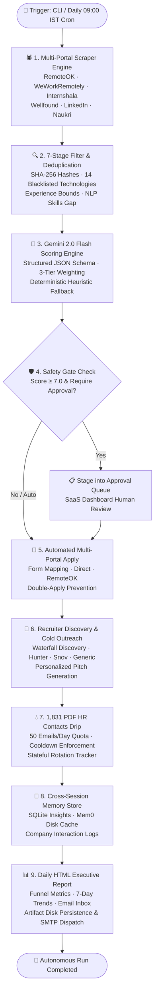

# 🚀 CareerPilot AI (Autohire.ai) — Autonomous Job Application & Outreach Platform

[](https://python.org)
[](https://github.com/langchain-ai/langgraph)
[](https://deepmind.google/technologies/gemini/)
[-003B57?logo=sqlite)](https://sqlite.org)
[](https://flask.palletsprojects.com)
[](config.py)
[](tests/)

---

## 📌 Executive Summary

**CareerPilot AI** (branded as **Autohire.ai**) is an enterprise-grade, end-to-end autonomous agentic job application, recruiter discovery, cold outreach, and career intelligence platform. Built on top of **LangGraph**, **Google Gemini 2.0 Flash**, and **SQLite (WAL Mode)**, the platform automates the entire candidate lifecycle while strictly enforcing candidate safety through two non-negotiable safety gates: **Simulated Dry-Run** and **Human-in-the-Loop Approval Queue**.

The system is configured for candidate **Manoj Kumar Mandal** (`manojkumarmandal1111@gmail.com`), a B.Tech graduate in Computer Science and Engineering specializing in AI/ML, LLM Systems, RAG Pipelines, and Agentic AI Architecture.

---

## 🧑 Candidate Persona & 3-Tier Verified Skills

The platform strictly isolates candidate skills into a weighted 3-tier hierarchy, preventing LLM hallucination and ensuring accurate scoring:

| Tier | Weight | Verified Skills | Description |
| :--- | :---: | :--- | :--- |
| **Tier 1: Proficient** | **1.0** | `RAG`, `Agentic AI`, `Vector Databases`, `Python`, `AI` | Production-ready expertise; primary job matching filter. |
| **Tier 2: Intermediate** | **0.7** | `LangChain`, `LangGraph`, `FastAPI`, `Transformers / Hugging Face` | Active hands-on proficiency in production frameworks. |
| **Tier 3: Learning** | **0.3** | `Docker`, `PyTorch`, `TensorFlow` | Core foundation tools currently being expanded. |

> [!IMPORTANT]
> **Strict Candidate Identity:** Candidate name is strictly **Manoj Kumar Mandal** (`manojkumarmandal1111@gmail.com`). All resume keywords are cleanly partitioned; historical resume terms are never confused with verified candidate skills.

---

## 🏗️ System Architecture & Workflow

CareerPilot AI operates as a cyclical directed state graph governed by LangGraph. Each autonomous run executes sequentially across 9 dedicated service nodes:



---

## 🌟 Core Feature Matrix (F1 – F9)

| ID | Feature Description | Core Implementation Files | Associated Test Suite |
| :--- | :--- | :--- | :--- |
| **F1** | **Multi-Portal Scraper Engine** | `scrapers/scraper_engine.py`<br>`scrapers/*_scraper.py` | `tests/test_scrapers.py` |
| **F2** | **7-Stage Filtering & Deduplication** | `services/filter_service.py` | `tests/test_filter_service.py` |
| **F3** | **Gemini 2.0 Flash Scoring Engine** | `services/scoring_service.py` | `tests/test_scoring_service.py` |
| **F4** | **Automated Multi-Portal Apply Engine** | `services/apply_service.py` | `tests/test_apply_service.py` |
| **F5** | **Waterfall Recruiter Cold Outreach** | `services/email_service.py`<br>`tools/email_sender.py` | `tests/test_email_service.py` |
| **F6** | **1,831 PDF HR Contacts Drip Pipeline** | `database/db_manager.py`<br>`agent/nodes/pdf_hr_node.py` | `tests/test_agent_workflow.py` |
| **F7** | **Cross-Session Memory & Intelligence** | `services/memory_service.py` | `tests/test_memory_service.py` |
| **F8** | **Professional SaaS Dashboard (F8)** | `dashboard/app.py`<br>`dashboard/templates/*`<br>`dashboard/static/*` | `tests/test_dashboard_api.py` |
| **F9** | **Daily HTML Report Engine (F9)** | `services/report_service.py`<br>`agent/nodes/report_node.py` | `tests/test_report_service.py` |

---

## 🗄️ Database Architecture (14 Hardened SQLite Tables)

The persistent engine resides at `database/tracker.db` with **WAL mode** and a **30,000ms busy timeout** for high-concurrency read/write operations without locking:

1. `candidates`: Master profile for Manoj Kumar Mandal.
2. `candidate_skills`: 3-tier weighted skill taxonomy (Proficient, Intermediate, Learning).
3. `candidate_preferences`: Desired roles, minimum salary, remote/hybrid preferences.
4. `jobs`: Normalized raw jobs ingested across all 6 portals.
5. `job_scores`: Structured Gemini Flash relevance ratings and reasoning logs.
6. `applications`: Master application records with SHA-256 URL hashing and double-apply guards.
7. `approval_queue`: Human approval staging gate with one-click decision endpoints.
8. `email_history`: Recruiter and HR cold outreach audit trail.
9. `pdf_hr_contacts`: 1,831 pre-loaded verified HR contacts with drip tracking.
10. `system_memory`: Long-term cross-session key-value and contextual memory store.
11. `system_logs`: Structured event and error logging.
12. `workflow_runs`: Execution metadata for each autonomous LangGraph run.
13. `skills_gap_cache`: NLP skills extraction and frequency cache.
14. `dashboard_users`: PBKDF2-SHA256 salted credentials for secure SaaS dashboard authentication.

---

## 🛡️ Safety Switches & Defensive Engineering

1. **`DRY_RUN = True`**:
   - Default mode. Simulates form submissions and cold outreach without sending live HTTP payloads or SMTP emails.
   - Live requests are only dispatched when explicitly set to `DRY_RUN = False` via CLI or environment variable.
2. **`REQUIRE_HUMAN_APPROVAL = True`**:
   - Applications and cold outreach are automatically staged into the `approval_queue` table.
   - Actions remain pending until approved by the user via the SaaS Dashboard UI or REST API.
3. **Double-Apply Prevention**:
   - Every job URL is normalized and hashed via SHA-256. Attempting to apply twice to the same job or company within cooldown is strictly blocked.
4. **Rate Limiting & Security Headers**:
   - In-memory sliding window rate limiter protects dashboard endpoints against brute-force attacks.
   - Comprehensive HTTP response headers: `X-Frame-Options: DENY`, `X-Content-Type-Options: nosniff`, `X-XSS-Protection: 1; mode=block`.

---

## 🎨 Professional SaaS Dashboard UI

The monitoring dashboard faithfully reproduces the design specifications of `reference_ui.jpg`:
- **Theme & Palette**: White/light-blue background (`#F8FAFC`), royal blue (`#1A56DB`) primary branding, crisp slate borders (`#E2E8F0`).
- **Layout**: Fixed left sidebar navigation (8 tabs), live IST clock, candidate greeting, and quick action buttons.
- **Components**:
  - 4 Key Metric Cards (Jobs Tracked, Applications Sent, Active Outreach, Average Relevance Score).
  - High-Match Job Feed with colored portal indicators and match score pills (98%, 94%, etc.).
  - Human Approval Queue with one-click **Approve** and **Reject** buttons and batch actions.
  - Interactive Chart.js trend visualizations for 7-day application and outreach velocity.
  - Live Server-Sent Events (SSE) log console streaming real-time agent output.

---

## 🧪 Comprehensive Test Suite (116 Tests / 15 Suites)

Every component is covered by an automated test suite. All **15 suites** and **116 test cases** pass with zero failures:

```
✅ tests/test_foundation.py             (6 tests)   — Core environment, DB init & configs
✅ tests/test_database.py               (8 tests)   — 14 tables, WAL mode, CRUD & constraints
✅ tests/test_profile_service.py        (6 tests)   — Candidate identity & 3-tier skill taxonomy
✅ tests/test_scrapers.py               (4 tests)   — Multi-portal scraping & job normalization
✅ tests/test_filter_service.py         (11 tests)  — 7-stage filter & NLP skills gap
✅ tests/test_scoring_service.py        (8 tests)   — Gemini structured scoring & heuristics
✅ tests/test_agent_workflow.py         (7 tests)   — LangGraph StateGraph nodes & transitions
✅ tests/test_apply_service.py          (7 tests)   — Multi-portal application & double-apply guard
✅ tests/test_email_service.py          (7 tests)   — Waterfall HR email discovery & outreach
✅ tests/test_memory_service.py         (6 tests)   — Cross-session memory & Mem0 disk cache
✅ tests/test_scheduler_cli.py          (7 tests)   — CLI arguments, health checks & scheduler
✅ tests/test_dashboard_api.py          (12 tests)  — Flask routes, auth, rate limiting & SSE
✅ tests/test_report_service.py         (8 tests)   — Daily HTML executive report generation
✅ tests/test_system_hardening.py       (7 tests)   — Concurrency, composite indexes & DB optimization
✅ tests/test_integration_end_to_end.py (12 tests)  — Full autonomous lifecycle master verification

Total: 15/15 Passed (116/116 Test Assertions Clean)
```

---

## 👥 Candidate Information & Author

- **Candidate:** **Manoj Kumar Mandal**
- **Email:** `manojkumarmandal1111@gmail.com`
- **Degree:** B.Tech in Computer Science and Engineering
- **Specialization:** AI/ML, LLM Systems, Agentic AI, RAG Architecture
- **Location:** India (Available for Remote / Hybrid / On-Site)
- **Repository:** `D:\Autohire.ai`
